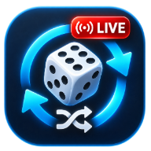
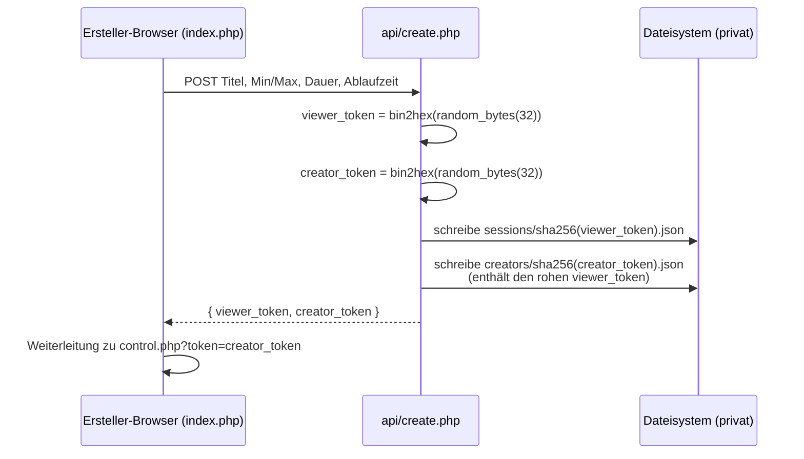
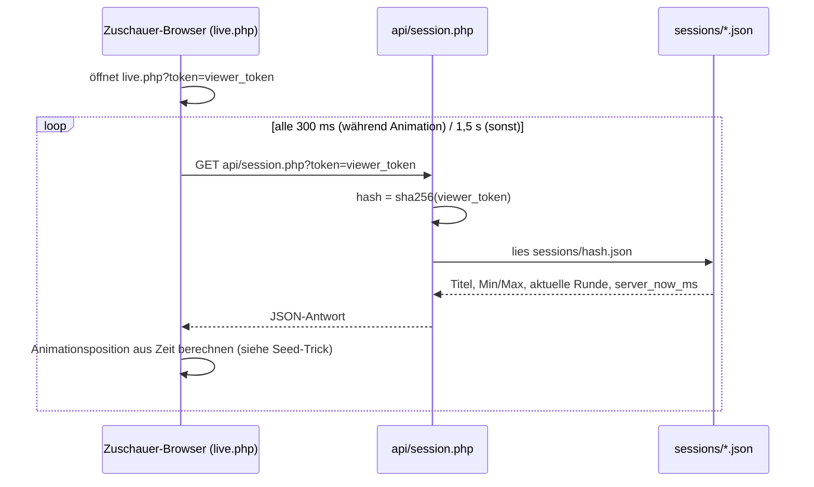
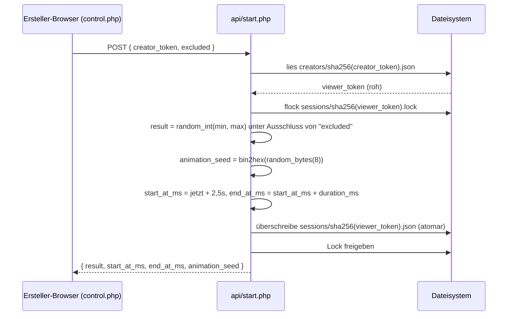
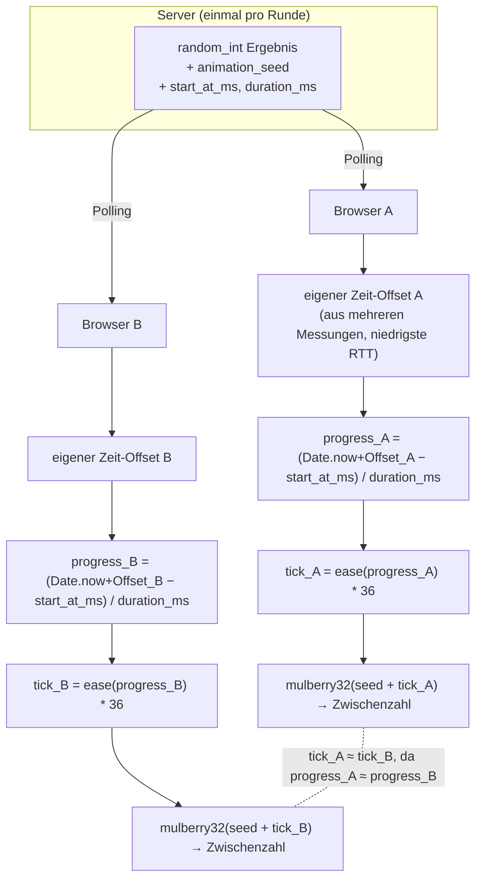

# Live-Zufallsgenerator




Synchronisierter Live-Zufallsgenerator für Standard-PHP-Webhosting. Kein Login,
kein Admin-Bereich, keine Datenbank – nur JSON-Dateien. Jeder kann eine Ziehung
erstellen; wer sie startet, wird nicht per Passwort geschützt, sondern durch
Besitz eines geheimen Links (wie bei einem freigegebenen Cloud-Dokument).

## Funktionsprinzip

1. Auf `index.php` wird eine neue Ziehung mit Zahlenbereich, Animationsdauer
   und Gültigkeitsdauer erstellt.
2. Die Anwendung erzeugt **zwei geheime Tokens**:
   - **Ersteller-Token** (`control.php?token=...`): zum Starten neuer Runden
     und zum sofortigen Löschen der Sitzung. Nur du bekommst diesen Link.
   - **Zuschauer-Token** (`live.php?token=...`): reine Anzeige, inkl. QR-Code
     zum Teilen. Wer diesen Link/QR-Code hat, kann nur zusehen, nichts auslösen.
3. Auf `control.php` klickst du auf „Zahl ziehen“, so oft du willst (mehrere
   Runden pro Sitzung sind möglich). Jeder Browser, der gerade den
   Zuschauer-Link offen hat, sieht dieselbe Animation und dasselbe Ergebnis,
   nahezu synchron.
4. Alle Browser berechnen die Animation selbst (kein Video-Stream). Der Server
   ermittelt die Zufallszahl **genau einmal** und liefert Start-/Endzeitpunkt,
   Dauer und einen deterministischen Animations-Seed; die Clients
   synchronisieren sich über eine geschätzte Serverzeit (mehrere
   Fetch-Messungen, niedrigste Round-Trip-Zeit bevorzugt).
5. Im Feld „Bereits gezogene Zahlen ausschließen“ auf `control.php` können
   vor jeder Ziehung Zahlen angegeben werden (getrennt mit `;`), die nicht
   mehr vorkommen sollen (z. B. weil sie schon einmal gezogen wurden). Nach
   jeder erfolgreichen Ziehung wird das Ergebnis automatisch zur Liste
   hinzugefügt; das Feld bleibt frei editierbar. Serverseitig wird effizient
   die k-te verbleibende Zahl im Bereich bestimmt (kein Durchprobieren), das
   funktioniert auch bei sehr großen Zahlenbereichen.

## Wie es technisch genau abläuft

### 0. Wie der Token erzeugt wird

Jeder der beiden Tokens (Zuschauer und Ersteller) entsteht durch genau einen
Aufruf:

```php
// src/bootstrap.php
function new_secret_token(): string
{
    return bin2hex(random_bytes(32));
}
```

- **`random_bytes(32)`** liefert 32 **echte Zufallsbytes** aus dem
  kryptografisch sicheren Zufallsgenerator (CSPRNG) des Betriebssystems
  (unter Linux `/dev/urandom`, unter Windows `CryptGenRandom`/`BCryptGenRandom`).
  Das ist bewusst **nicht** `rand()` oder `mt_rand()` — jene erzeugen
  vorhersagbare Pseudozufallsfolgen, die sich bei Kenntnis des internen
  Zustands (Seed) rekonstruieren lassen. Für ein Sicherheits-Token wäre das
  ein Problem, für reine Zufallszahlen in der Ziehung selbst nicht.
- **`bin2hex(...)`** wandelt die 32 Rohbytes nur in eine lesbare,
  URL-taugliche Zeichenkette aus 64 Hex-Zeichen (`0`–`9`, `a`–`f`) um —
  das verändert die Zufälligkeit nicht, es ist nur Darstellung.
- **Entropie:** 32 Byte = 256 Bit Zufall. Die Anzahl möglicher Werte ist
  2²⁵⁶ — selbst mit sehr vielen Versuchen pro Sekunde ist Erraten oder
  Durchprobieren praktisch ausgeschlossen (es gibt schlicht keinen
  Angriffsweg außer Erraten, da der Wert nirgends abgeleitet, sondern rein
  zufällig erzeugt wird).
- Jede Sitzung bekommt **zwei unabhängig gewürfelte** solche Tokens
  (`viewer_token` für `live.php`, `creator_token` für `control.php`) —
  der eine lässt sich nicht aus dem anderen berechnen, da beide völlig
  unabhängige Zufallswerte sind.

Dieser Token *ist* bereits das Zugangsgeheimnis — es gibt kein Passwort und
keinen Login dahinter. Wer den Token (bzw. den Link oder QR-Code, die ihn
enthalten) kennt, hat Zugriff; wer ihn nicht kennt, kann ihn praktisch nicht
erraten.

### 1. Sitzung erstellen — welche Dateien dabei entstehen

Pro **Sitzung** (nicht pro einzelner Ziehung!) entstehen genau zwei JSON-Dateien
plus eine leere Lockdatei:

| Datei | Inhalt | Dateiname |
|---|---|---|
| `sessions/<hash>.json` | Titel, Zahlenbereich, aktuelle Runde, Ablaufzeit | `sha256(viewer_token)` |
| `sessions/<hash>.lock` | leer, nur für `flock()` | `sha256(viewer_token)` |
| `creators/<hash>.json` | Pointer: enthält den rohen `viewer_token` | `sha256(creator_token)` |

Dazu kommt noch eine dritte, von einzelnen Sitzungen unabhängige Dateiart für
das Rate-Limit beim Erstellen ([src/bootstrap.php:114-138](src/bootstrap.php#L114-L138)):

| Datei | Inhalt | Dateiname |
|---|---|---|
| `ratelimit/<hash>.json` | reine JSON-Liste von Unix-Zeitstempeln (Sekunden), z. B. `[1793730000,1793730041]` — ein Eintrag pro `api/create.php`-Aufruf dieser IP in den letzten 10 Minuten | `sha256("create\|" + IP-Adresse)` |

Wichtig: **Die IP-Adresse selbst steht nirgends im Dateiinhalt**, nur als
Hash im Dateinamen. Jeder Aufruf von `api/create.php` filtert zuerst alle
Zeitstempel heraus, die älter als das Zeitfenster (`create_rate_limit_window_s`,
Standard 600s) sind, prüft dann, ob weniger als `create_rate_limit_count`
(Standard 10) übrig sind — wenn nicht, wird der Request mit HTTP 429
abgelehnt — und hängt sonst den aktuellen Zeitstempel an. Diese Dateien
gehören zu keiner einzelnen Sitzung, sondern zu einer IP-Adresse; sie
entstehen schon beim ersten `api/create.php`-Versuch, unabhängig davon, ob
danach tatsächlich eine Sitzung erfolgreich angelegt wird.



**Wichtig:** Klickst du danach mehrmals auf „Zahl ziehen“, entstehen **keine
weiteren Dateien**. Die bestehende `sessions/<hash>.json` wird bei jeder neuen
Runde einfach mit dem neuen Ergebnis überschrieben (atomar, siehe unten). Eine
dritte Dateiart, `ratelimit/<hash>.json`, hat nichts mit einzelnen Sitzungen zu
tun — sie zählt nur, wie oft eine IP-Adresse kürzlich `api/create.php`
aufgerufen hat, unabhängig davon, wie viele Sitzungen dabei entstanden sind.

### 2. Zuschauer-Link öffnen — wie der Token die Datei findet



Kein Index, keine Datenbank-Abfrage: Der Server rechnet aus dem Token direkt
den Dateinamen aus und öffnet genau diese eine Datei. Unbekannter oder falscher
Token → der berechnete Hash passt zu keiner existierenden Datei → Antwort
`"state": "invalid"`, bewusst identisch zur Antwort bei abgelaufenen Sitzungen
(kein Unterschied nach außen erkennbar).

### 3. „Zahl ziehen“ — wie der Ersteller-Token die Runde auslöst



Die `flock()`-Sperre auf der separaten `.lock`-Datei verhindert, dass zwei
gleichzeitige Klicks auf „Zahl ziehen“ zwei Runden gleichzeitig anlegen: Der
zweite Request wartet, sieht danach die bereits aktive Runde und wird mit
Fehler „Es läuft bereits eine Runde“ abgewiesen.

### 4. Der Seed-Trick — warum alle Browser dasselbe sehen

Zwei getrennte Probleme müssen gelöst werden: **welche** Zahl gerade angezeigt
wird, und **wann** genau sie wechselt.

**a) Welche Zahl:** Kein Browser würfelt selbst mit `Math.random()` — das würde
auf jedem Gerät etwas anderes anzeigen. Stattdessen liefert der Server einen
`animation_seed` (einmal zufällig gezogen, zusammen mit dem echten Ergebnis).
Jeder Browser füttert `seed + tick` in einen deterministischen
Pseudozufallsgenerator (mulberry32): gleicher Seed + gleicher Tick → exakt
dieselbe Zahl, auf jedem Gerät.

**b) Wann genau:** `tick` wird nicht gezählt, sondern aus der **Zeit**
berechnet:

```
progress = (geschätzte_Serverzeit − start_at_ms) / duration_ms
tick      = ease(progress) * 36        // 36 Zwischenschritte, am Ende langsamer
```

Jede Uhr tickt aber leicht anders. Deshalb schätzt jeder Client die
**Serverzeit** separat: Er merkt sich für jede Polling-Anfrage den eigenen
Sende- und Empfangszeitpunkt sowie die vom Server mitgelieferte `server_now_ms`,
und bevorzugt die Messung mit der **niedrigsten Laufzeit** (Round-Trip-Time) als
genaueste Schätzung des Zeit-Offsets zwischen eigener Uhr und Serveruhr.



Weil `progress_A` und `progress_B` (fast) gleich sind, landen beide Browser
(fast) gleichzeitig beim gleichen `tick` und damit bei derselben Zwischenzahl —
ganz ohne dass sich die Browser direkt austauschen. Am Ende (`progress ≥ 1`)
zeigen beide dasselbe, am Server gespeicherte `result`. Kleine Abweichungen
durch Netzwerklatenz sind möglich; es ist eine gute Näherung, keine
millisekundengenaue Garantie.

### 5. Der Seed-Trick in eigenen Worten

*(Diese Zusammenfassung habe ich mir selbst noch einmal in eigenen Worten
aufgeschrieben, um das System wirklich zu verstehen.)*

Der Trick besteht darin, dass bereits **vor** der Animation sowohl das
Ergebnis als auch der Seed zufällig bestimmt und am Server gespeichert
werden. Der Zuschauer führt alle 300ms einen Fetch durch und bekommt dabei
genau diese gezogene Zahl und den Seed mitgeliefert. Jeder Browser erzeugt
sich daraus selbst einen `tick`, abgeleitet aus der aktuellen Uhrzeit. Weil
diese Uhrzeit bei allen (synchronisiert) fast gleich ist, haben auch alle
Browser (fast) denselben `tick`.

Weil Seed und Tick bei allen (nahezu) identisch sind, erzeugt die
`mulberry32`-Funktion bei allen dieselbe "pseudozufällige" Zwischenzahl
während der Animation — ganz ohne dass sich die Browser direkt
austauschen müssten.

**Pseudozufall, Buchseiten-Analogie:** Der Seed ist wie eine Seitenzahl in
einem dicken Buch mit lauter scheinbar zufälligen Zahlenfolgen. Wer dieselbe
Seitenzahl bekommt, schlägt immer dieselbe Seite auf und liest dieselbe
Zahlenfolge — für den, der den Seed kennt, ist das Ergebnis also gar nicht
zufällig, sondern exakt vorhersagbar. Für einen Außenstehenden, der den Seed
nicht kennt, wirkt die Zahl trotzdem völlig willkürlich.

Drei Fragen, die ich mir dabei selbst gestellt (und beantwortet) habe:

**Was ist die `tick`-Variable genau?** Einfach ein Zähler von 0 bis 36, der
angibt, an welcher von 36 Zwischenstationen der Animation man gerade steht.
Er wird nicht hochgezählt, sondern bei jedem Frame neu aus dem aktuellen
Zeitfortschritt berechnet — deshalb kommen alle (synchronisierten) Browser
auf denselben Wert, ohne sich abzusprechen.

**Was ist das "ease"?** Eine kleine Formel (`1 - (1-progress)³`), die den
Zeitfortschritt verzerrt, statt ihn 1:1 in `tick` umzurechnen: am Anfang der
Runde steigt sie schnell (→ `tick` wechselt oft → Zahl flackert schnell),
gegen Ende steigt sie nur noch langsam (→ `tick` bleibt länger gleich → Zahl
wechselt seltener). Das erzeugt den "wird langsamer"-Effekt am Schluss der
Animation, rein optisch, ohne Einfluss auf das echte Ergebnis.

**Warum kommt aus der langen Mulberry-Zeichenkette am Ende eine Zahl heraus,
die genau im Min/Max-Bereich liegt?** Weil das in zwei Schritten passiert.
Mulberry32 liefert zuerst nur eine Dezimalzahl zwischen 0 und 1 — noch ganz
ohne Bezug zu `min`/`max`. Erst danach wird das umgerechnet:
`min + Math.floor(zufallszahl * (max - min + 1))`. Die Zufallszahl (0 bis 1)
wird auf die Breite des Zahlenbereichs gestreckt, abgerundet auf eine
Ganzzahl, und dann um `min` verschoben. Dadurch landet das Ergebnis
rechnerisch immer exakt zwischen `min` und `max`, egal wie "lang" oder
kryptisch der Zwischenwert von Mulberry32 selbst aussieht.

## Voraussetzungen

- PHP 8.2+, HTTPS.
- Schreibrechte für den Webserver-Benutzer auf dem privaten Datenverzeichnis
  (Standard: `private/live-draw/` neben den PHP-Dateien).
- Keine Datenbank, kein Cronjob, kein Node.js/WebSocket-Prozess nötig.

## Installation

1. Projektdateien auf den Webspace hochladen.
2. **Vendor-Bibliotheken bereitstellen** (siehe `assets/vendor/README.md`):
   `bootstrap.min.css` und `qrcode.min.js` einmalig herunterladen und in
   `assets/vendor/` ablegen.
3. `config.example.php` nach `config.php` kopieren und bei Bedarf anpassen
   (Pfad zum privaten Verzeichnis, erlaubte Zahlenbereiche, Rate-Limits).
4. Optional: `config.turnstile.example.php` nach `config.turnstile.php`
   kopieren und mit echten Cloudflare-Turnstile-Keys befüllen (siehe
   Abschnitt „Cloudflare Turnstile“ unten). Ohne diesen Schritt bleibt
   Turnstile deaktiviert, die Anwendung funktioniert trotzdem normal.
5. **Falls das Hosting einen Ordner außerhalb des Webroots erlaubt**: das
   Verzeichnis `private/live-draw` (und idealerweise auch `config.php`) dorthin
   verschieben und den Pfad in `config.php` entsprechend anpassen.
6. Falls nur ein Webroot zur Verfügung steht: sicherstellen, dass die dort
   automatisch angelegte Datei `private/live-draw/.htaccess`
   (`Require all denied` / `Deny from all`) tatsächlich wirkt – im Browser
   `https://deine-domain/private/live-draw/.htaccess` aufrufen und einen
   403/404-Fehler erwarten. Bei Nginx oder anderen Servern ohne `.htaccess`-
   Unterstützung muss der Zugriff äquivalent in der Server-Konfiguration
   gesperrt werden. Dasselbe gilt für `src/.htaccess` und
   `partials/.htaccess` (reine PHP-Includes, nie direkt aufzurufen) sowie die
   `Options -Indexes`-Regel in der Root-`.htaccess` gegen Verzeichnislisting.
7. Schreibrechte prüfen: Das erste Erstellen einer Sitzung legt automatisch
   die Unterordner `sessions/`, `creators/`, `ratelimit/` sowie die
   `.htaccess`-Datei an (Verzeichnisse `0700`, Dateien `0600`, soweit vom
   Hosting unterstützt).
8. `index.php` im Browser öffnen und eine Testsitzung erstellen.

## Sicherheitsmodell (ohne Login)

- Beide Tokens sind kryptografisch sichere Zufallswerte
  (`bin2hex(random_bytes(32))`, 64 Hex-Zeichen) – nicht erratbar.
- Dateinamen im privaten Verzeichnis werden ausschließlich aus
  `sha256(token)` gebildet, nie aus Nutzereingaben. Der rohe Zuschauer-Token
  wird nirgends gespeichert; der rohe Ersteller-Token nur in der eigenen,
  gleich gut geschützten Pointer-Datei.
- Start/Löschen erfordern den Ersteller-Token als expliziten Wert im
  POST-Body (kein Cookie/Session). Ein klassischer CSRF-Angriff über eine
  fremde Seite kann diesen Wert nicht erraten, da kein Ambient-Login
  existiert, auf das sich die fremde Seite stützen könnte.
- `Referrer-Policy: no-referrer` und `Cache-Control: no-store` auf allen
  Token-Seiten/-Antworten, damit Links nicht versehentlich über
  Referrer-Header oder Caches an Dritte durchsickern.
- Einfaches IP-basiertes Rate-Limit auf `api/create.php`, damit das
  öffentliche Erstellen nicht automatisiert missbraucht wird.
- Zahlenbereich, Animationsdauer und Titel werden serverseitig validiert;
  dynamische Ausgaben werden escaped (`htmlspecialchars`).

**Wichtig:** Der QR-Code bzw. der Zuschauer-Link ist kein hartes Geheimnis
gegen Mitlesen vor Animationsende – wer mit Entwicklerwerkzeugen die
API-Antwort inspiziert, sieht das Ergebnis theoretisch schon während der
Animation. Für die meisten Anwendungsfälle (Tombola, Teamauslosung, Spiele)
ist das unkritisch; falls ein wirklich geheimes Ergebnis bis zum Schluss
nötig ist, muss das Protokoll in `api/session.php` angepasst werden
(Ergebnis erst nach `end_at_ms` ausliefern).

## Automatische Löschung ohne Cronjob

- Jede Sitzung hat ein serverseitig festgelegtes `expires_at_ms` (Standard
  24 Stunden, in `index.php` wählbar). Danach sind sowohl Zuschauer- als
  auch Ersteller-Aktionen sofort gesperrt, unabhängig davon, ob die Datei
  physisch schon gelöscht wurde.
- Bei ca. 1 % der API-Aufrufe (`CleanupService::maybeRun()`, gedrosselt auf
  höchstens einen Lauf pro Minute über eine Marker-Datei) werden eindeutig
  abgelaufene Sitzungs- und Pointer-Dateien entfernt. Auch veraltete
  Rate-Limit-Dateien (älter als das Zeitfenster) werden dabei entfernt.
- Bei sehr geringem Traffic kann die physische Löschung dadurch erst beim
  nächsten passenden Request erfolgen – die Sitzung ist aber ab
  `expires_at_ms` trotzdem sofort logisch ungültig.
- Der Ersteller kann eine Sitzung über „Sitzung jetzt löschen“ in
  `control.php` zusätzlich sofort entfernen.
- Optional kann ein externer Cronjob zusätzlich `CleanupService::run()`
  aufrufen (z. B. über ein eigenes kleines CLI-Skript); er ist aber keine
  Voraussetzung für den Betrieb.

## Synchronisierung (Zusammenfassung)

- Jeder Client schätzt die Serverzeit aus mehreren Fetch-Messungen und
  bevorzugt die Messung mit der niedrigsten Laufzeit (Details siehe „Wie es
  technisch genau abläuft“ oben). Das ist eine Näherung, **keine
  millisekundengenaue Garantie**.
- Beim Laden mitten in einer Runde wird direkt an der passenden
  Animationsposition eingestiegen; nach Rundenende erscheint sofort das
  Endergebnis.
- Bei `visibilitychange` (Tab wird wieder aktiv) wird sofort neu abgefragt
  und die Animation aus dem Zeitplan neu aufgebaut statt einen pausierten
  Timer fortzusetzen.
- `prefers-reduced-motion: reduce` wird respektiert: Es werden nur dezente
  Übergänge statt der schnellen Zahlenanimation gezeigt.

## Getestete Randfälle

- Zwei schnelle Klicks auf „Zahl ziehen“: `JsonSessionStore::withLock()`
  serialisiert Schreibzugriffe über eine separate `.lock`-Datei; der zweite
  Request sieht die bereits aktive Runde und wird mit Fehler „Es läuft
  bereits eine Runde“ (HTTP 409) abgewiesen.
- Geänderter/falscher Token: `api/session.php` liefert für unbekannte,
  beschädigte oder abgelaufene Sitzungen bewusst dieselbe generische
  `"state": "invalid"`-Antwort (kein Unterschied zwischen „existiert nicht“
  und „abgelaufen“, kein Daten-Leck).
- Verzögerte/doppelte Netzwerk-Antworten: `draw-view.js` verwirft Antworten
  auf ältere Anfragen, falls eine neuere Anfrage bereits angewendet wurde.
- Abgelaufene Sitzung: Start/Löschen liefern HTTP 410, Zuschauer sehen
  „Link ungültig oder abgelaufen“.

## Cloudflare Turnstile (optional)

Schützt ausschließlich das öffentliche Erstellen neuer Sitzungen
(`index.php` → `api/create.php`) vor automatisiertem Missbrauch. Das
Starten weiterer Runden auf `control.php` benötigt dagegen **keine**
erneute Turnstile-Prüfung, da der Zugriff auf `control.php` ohnehin schon
den geheimen Ersteller-Token voraussetzt (den man nur nach erfolgreicher
Erstellung bekommt) – ein Turnstile-Token ist nur einmal gültig, eine
Prüfung bei jedem einzelnen Klick auf „Zahl ziehen“ wäre daher unnötig
umständlich (Widget müsste nach jeder Runde neu geladen werden).

Einrichtung:

1. Im Cloudflare-Dashboard unter „Turnstile“ einen Site-Key und Secret-Key
   erzeugen.
2. `config.turnstile.example.php` nach `config.turnstile.php` kopieren und
   beide Keys eintragen.

Sind beide Keys leer (Standard), wird kein Widget angezeigt und keine
Prüfung durchgeführt – die Anwendung funktioniert dann genauso wie ohne
Turnstile.

## Bekannte Einschränkungen

- Die geschätzte "aktive Zuschauerzahl" aus der Original-Spezifikation
  wurde bewusst weggelassen (kein zuverlässiger Mechanismus ohne zusätzliche
  Serverlast/Komplexität in einer reinen Datei-basierten Architektur).
- Keine SSE/WebSocket-Variante; Polling (300 ms während einer Runde, sonst
  1,5 s, mit Backoff bei Fehlern) ist bewusst die einzige Transportart, um
  auf Standard-Shared-Hosting ohne Zusatzprozesse zu funktionieren.
- Das Rate-Limit auf `api/create.php` ist eine einfache IP-basierte
  Bremse, kein vollständiger Bot-/Abuse-Schutz.

## Lizenz und Danksagung

Dieses Projekt steht unter der **GNU General Public License v3.0** (siehe
`LICENSE`).

Herzlichen Dank an die Autoren der beiden lokal eingebundenen
Open-Source-Bibliotheken, ohne die QR-Code-Erzeugung und das Styling deutlich
aufwändiger gewesen wären (beide MIT-lizenziert, vollständiger Lizenztext in
`THIRD_PARTY_LICENSES.md`):

- **[Bootstrap](https://getbootstrap.com/)** — The Bootstrap Authors
- **[qrcode-generator](https://github.com/kazuhikoarase/qrcode-generator)** — Kazuhiko Arase
